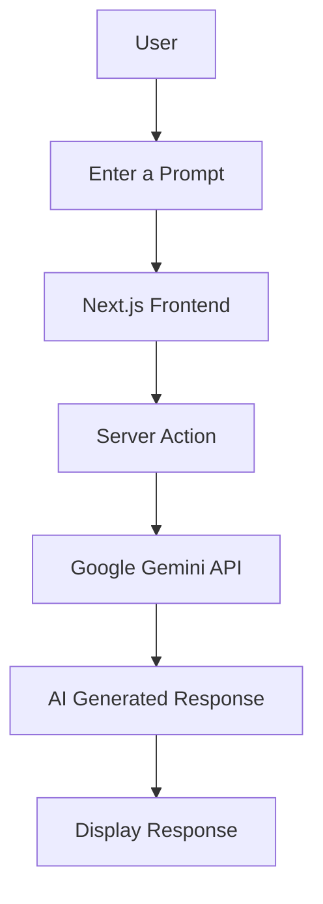

# ✨ Google Gemini AI Chat

A simple AI-powered chat application built with **Next.js, TypeScript, Tailwind CSS, and Google Gemini API**. Ask questions and get AI-generated responses through a clean and minimal interface.

## 🚀 Overview

Google Gemini AI Chat is a beginner-friendly AI chat application that connects Google's Gemini API with a Next.js frontend.

## 🖥️ Preview

> Add a screenshot of your application here.

<!-- Replace this with your actual screenshot -->
<!--  -->

## ✨ Features

- 🤖 AI-generated responses using Google Gemini.
- 💬 Simple chat interface.
- ⚡ Fast application powered by Next.js.
- 🎨 Minimal dark-themed UI.
- 📱 Responsive layout.
- ⌨️ Send messages using the Enter key.

## 🛠️ Tech Stack

| Technology | Purpose |
|---|---|
| Next.js | React framework |
| TypeScript | Type safety |
| Tailwind CSS | Styling |
| Google Gemini API | AI responses |

## 🔄 How It Works



## 📂 Project Structure

```text
chat-app/
├── app/
│   ├── actions/
│   │   └── aiAction.ts
│   ├── page.tsx
│   ├── layout.tsx
│   └── globals.css
├── public/
├── .env.local
├── next.config.ts
├── package.json
└── README.md
```

## ⚙️ Getting Started

### 1. Clone the repository

```bash
git clone https://github.com/Renjero/GoggleAi-GoogleAi-chats.git
```

### 2. Navigate to the project

```bash
cd GoggleAi-GoogleAi-chats
```

### 3. Install dependencies

```bash
npm install
```

### 4. Configure environment variables

Create a `.env.local` file in the root directory:

```env
GEMINI_API_KEY=your_google_gemini_api_key
```

Get your API key from [Google AI Studio](https://aistudio.google.com/).

### 5. Run the development server

```bash
npm run dev
```

Open [http://localhost:3000](http://localhost:3000) in your browser.

## 🔐 Security
